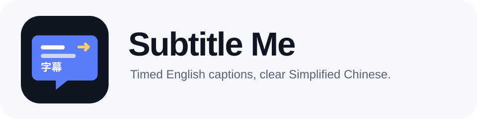
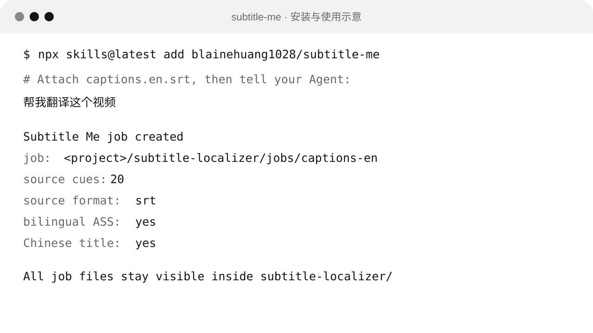
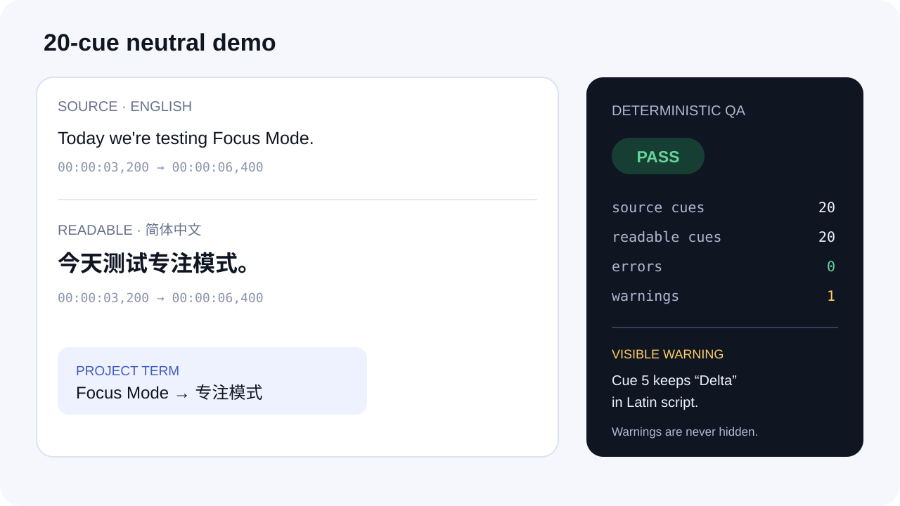

<p align="center">
  <picture>
    <source media="(prefers-color-scheme: dark)" srcset="./skills/subtitle-me/assets/logo-dark.svg">
    <source media="(prefers-color-scheme: light)" srcset="./skills/subtitle-me/assets/logo-light.svg">
    
  </picture>
</p>

<p align="center">
  <a href="https://github.com/blainehuang1028/subtitle-me/actions/workflows/test.yml"></a>
  
  <a href="./LICENSE"></a>
</p>

<p align="center">
  Translate timed English captions into reviewed Simplified Chinese. Keep names consistent with a project glossary, then have your agent review the translation against the source.
</p>

<p align="center">
  <a href="https://skills.heyblaine.com/subtitle-me/">Website</a> ·
  <a href="#install">Install</a> ·
  <a href="#use">Use</a> ·
  <a href="#features">Features</a>
</p>

## Install

```bash
npx skills@latest add blainehuang1028/subtitle-me
```

Node.js 20 or newer is required.



## Use

Give your agent an SRT, WebVTT, YouTube JSON3, or ASS subtitle file and say:

```text
Translate this video with subtitle-me.
```

You can also specify the outputs:

```text
Use subtitle-me to translate captions.en.srt into Simplified Chinese.
Deliver bilingual Chinese-English ASS subtitles and a Chinese video title.
```

By default, Subtitle Me delivers readable Chinese SRT and bilingual ASS, with one row per language. You can explicitly request Chinese-only or English-only output. Video titles and descriptions are optional; descriptions include source and author attribution.

## Features

- Translate timed English subtitles into Simplified Chinese.
- Start each project with an empty glossary for names, brands, and technical terms.
- Preserve a faithful translation and generate a separate version for single-line reading.
- Perform a second source-to-translation review, then check omissions, numbers, terminology, and timing.
- Generate bilingual ASS by default, with Chinese-only or English-only output on request.
- Optionally write a video title and a description with source and author attribution.
- Review natural phrasing in context while preserving tone, conditions, and the role of jokes.
- Recheck changed cues and their neighbors while reusing unchanged, approved review coverage.



All working files stay in the current project's visible `subtitle-localizer/` directory. Glossaries are not shared across projects and contain no preloaded terms. The agent asks for permission before researching terminology online.

## Version 0.2.0: natural phrasing and scoped review

The translation guidance includes two worked examples:

- A real historical translation of "The consequences have been real." added a stronger emotional judgment. The revised example removes that addition and follows the source's intensity.
- An invented teaching example of "Once you finish reloading, you can keep firing." shows how to make the Chinese more concise while preserving the timing relationship.

These are editing examples, not benchmarks of other skills or general AI translation quality. See the [sources, context, and counterexamples](docs/translation-examples.zh-CN.md).

Contrastive phrasing remains appropriate when the source explicitly corrects a misunderstanding. Splitting a subtitle into shorter cues does not create more reading time; conditions, negation, and key facts must remain intact.

[Full changelog](CHANGELOG.md) · [Subtitle work on Bilibili](https://space.bilibili.com/1602220899)

Existing jobs retain their output options. Old review records need one complete review before incremental reuse. Single-language delivery still retains bilingual working files for internal QA. Readable Chinese subtitles use one line per cue.

## Inputs and outputs

Supported inputs:

- SRT
- WebVTT
- YouTube JSON3
- ASS dialogue

Main outputs:

- `semantic.zh-Hans.srt`: faithful Chinese translation.
- `readable.zh-Hans.srt`: Chinese subtitles arranged for single-line screen reading.
- `bilingual.zh-en.ass`: bilingual ASS by default, or single-language output on request.
- `title.zh-Hans.md`: optional video title.
- `description.zh-Hans.md`: optional video description.
- `report.md`: terminology, review, and QA results.

## Current scope

Version 0.2.0 requires timed English subtitles supplied by the user. It does not perform speech recognition, download media, burn subtitles into video, create dubbing or TTS, upload to platforms, or translate arbitrary language pairs.

Generating ASS does not require FFmpeg. FFmpeg is checked only when you request a rendered preview; it is not installed automatically if missing.

## Compatibility

- Codex: installation and a complete example have been verified.
- Hermes Agent, OpenCode, Pi, OpenClaw, and Trae: compatible with the general Agent Skill structure; not individually verified.
- WorkBuddy: import a ZIP from [GitHub Releases](https://github.com/blainehuang1028/subtitle-me/releases).

## License

[MIT](./LICENSE) © 2026 Kai Huang
